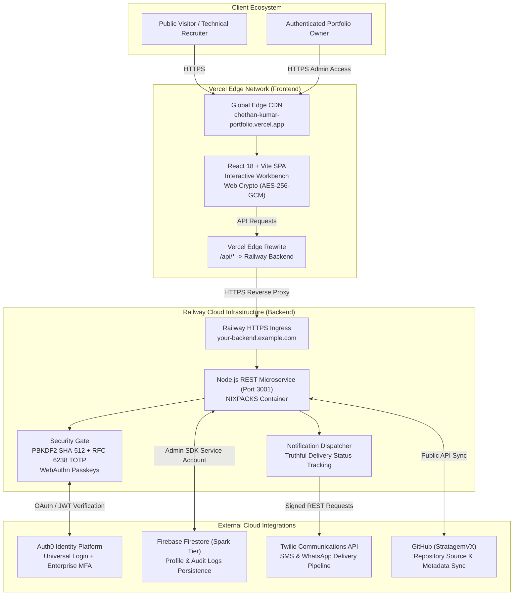

# Production Deployment Architecture: Chethan Kumar B S Engineering Portfolio

---

## Technical Specifications Summary

| Component | Provider | Configuration |
| :--- | :--- | :--- |
| **Frontend Application** | Vercel | Vite SPA, Global Edge Network, Custom Security Headers |
| **Backend REST Microservice** | Railway | Node.js v22 HTTP server, NIXPACKS builder, Railway Port Binding |
| **Identity & Authentication** | Auth0 & In-House Security Gate | Universal Login, PBKDF2 SHA-512, RFC 6238 TOTP, WebAuthn Passkeys |
| **Persistent Storage** | Firebase Firestore (Spark Tier) | Owner Profile, Security Audit Logs, FCM Device Tokens |
| **Security Telemetry Alerts** | Twilio | SMS & WhatsApp alerts with delivery verification |
| **Codebase Synchronization** | GitHub Actions (`StratagemVX`) | Automated daily sync for repository metrics and project index |
