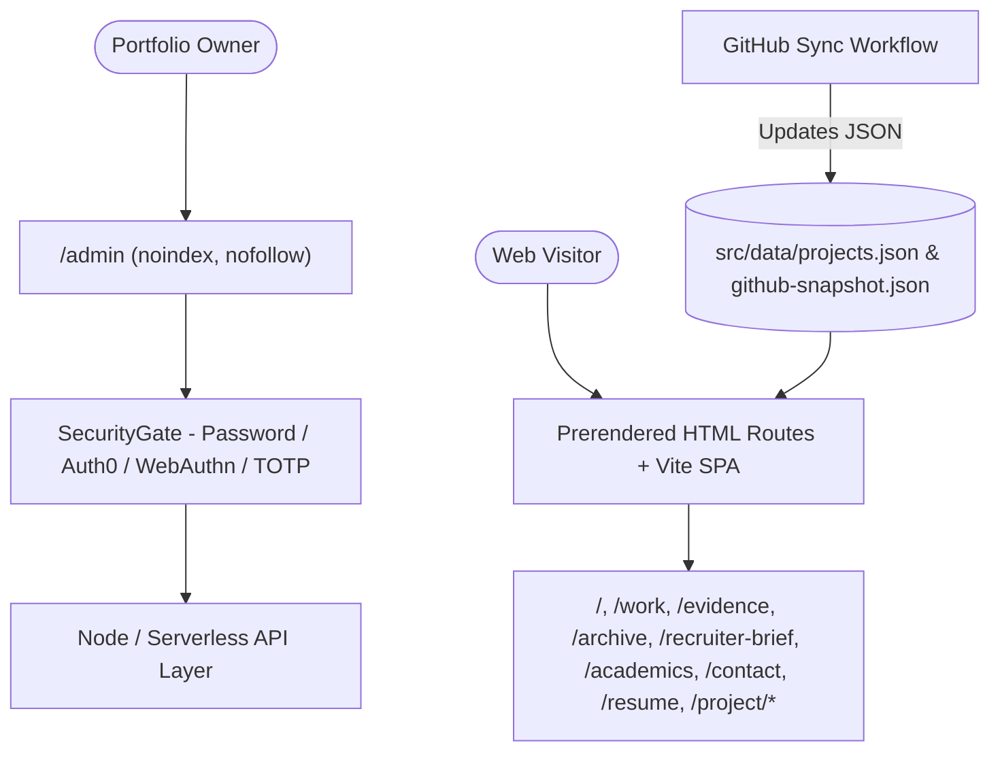

# Chethan Kumar — Personal Engineering Portfolio Website

> Full-stack personal engineering portfolio built with React 18, TypeScript, Vite, Tailwind CSS, static route prerendering, Vercel/Node serverless API handlers, WebAuthn/TOTP/Auth0 security controls, and automated GitHub repository synchronization.

[](https://react.dev/)
[](https://www.typescriptlang.org/)
[](https://vitest.dev/)
[](https://tailwindcss.com/)

---

## Executive Overview

This repository houses the portfolio application of Chethan Kumar B S (`StratagemVX`). It combines:

- **Static-Prerendered React SPA (`scripts/generate-static-pages.mjs`):** Generates standalone route HTML shells alongside `vite build` for fast initial load, Open Graph tags, canonical URLs, Schema.org JSON-LD, and SEO/AI discoverability (`public/llms.txt`, `public/ai-catalog.json`, `public/.well-known/ard.json`, `public/.well-known/ai-catalog.json`, `public/robots.txt`, `public/sitemap.xml`) while isolating `/admin` with `noindex, nofollow`.
- **Client-Side Engineering Workbench (`src/components/home/EngineeringWorkbench.tsx`):** Browser-native Web Crypto API sandbox (AES-256-GCM / PBKDF2) without transmitting plaintext to the server.
- **Automated GitHub Synchronization (`scripts/sync-github.mjs`, `.github/workflows/github-sync.yml`):** Refreshes `src/data/projects.json` and `src/data/github-snapshot.json` from public repository metadata while preserving curated architectural case studies.
- **Node.js & Serverless API Layer (`server/`, `api/serverless.ts`):** Compiled via `esbuild` (`npm run build:api`) into `api/index.js` and `api/[...path].js`.
- **Owner Security Perimeter (`src/pages/AdminDashboardPage.tsx`, `src/components/admin/SecurityGate.tsx`):** Fails closed on authentication; supports password + RFC 6238 TOTP, single-use recovery codes, W3C WebAuthn/FIDO2 passkeys, Auth0 JWT verification, and optional Firebase / Twilio notification channels.

### Active Remediation PRs

Three open Draft PRs organize the 2026 technical remediation against `main`:

1. **PR #1 (`security/fail-closed-admin-auth`):** Enforces fail-closed `ADMIN_PASSWORD` / `SECURITY_HMAC_KEY` startup validation, strict Auth0 JWT/JWKS claim verification, strict `CORS_ALLOWED_ORIGINS` validation, server-derived WebAuthn origin/RP-ID & one-time challenge binding, owner session checks across admin/MFA/notification endpoints, secret redaction in logs/responses, zero-vulnerability dependency upgrades (`react-router-dom@^7.18.5`, `vite@^7.3.8`, `esbuild@^0.28.2`, `vitest@^4.1.12`), expanded `tests/security-hardening.test.ts`, and `.github/workflows/quality.yml`.
2. **PR #2 (`docs/readme-maintenance-2026`):** Aligns `README.md`, `.env.example`, environment inventories, local setup/testing/troubleshooting guides, and `audit-reports/` with verified repository state while redacting personal emails, phone numbers, and private URLs.
3. **PR #3 (`perf/lighthouse-a11y-ai-discoverability`):** Hardens WCAG 2.2 AA contrast/labels/focus visibility, optimizes mobile LCP via critical CSS inlining + route chunk preloads + lazy admin sub-section splitting, upgrades dependencies to zero vulnerabilities, adds reproducible Playwright (`tests/e2e/portfolio.e2e.ts`) + `axe-core` + 3-run Lighthouse tooling (`scripts/run-lighthouse-audit.mjs`, `scripts/serve-production-preview.mjs`), and expands `.github/workflows/perf-a11y-csp.yml`.

---

## Architecture Overview



---

## Local Setup & Installation

### Prerequisites

- **Node.js:** `v20.x` or `v22.x` (`node --version`)
- **npm:** `v10.x` (`npm --version`)

### Install Dependencies

```bash
git clone https://github.com/StratagemVX/myportfolio.git
cd myportfolio
npm ci
```

### Environment Configuration (Local Dev vs. Production)

Copy `.env.example` to `.env.local` for local development. **Never commit populated `.env` files, real tokens, or personal contact details.**

- **Local Development (`NODE_ENV=development`):** Configure `ADMIN_PASSWORD`, `SECURITY_HMAC_KEY`, and `CORS_ALLOWED_ORIGINS=http://localhost:5173,http://localhost:3000`. Optional Auth0, Firebase Firestore, and Twilio providers fall back cleanly to local JSON storage (`server/security-state.json`, `server/notifications-log.json`) and blocked-configuration diagnostics when unconfigured.
- **Production (`NODE_ENV=production`):** Set real high-entropy secrets in your hosting provider's encrypted secret store (Vercel / Railway). Placeholder values (such as `.env.example` strings or weak defaults), short keys, and localhost CORS origins are rejected fail-closed at startup. See [`PRODUCTION_ENVIRONMENT_VARIABLES.md`](PRODUCTION_ENVIRONMENT_VARIABLES.md) and [`docs/LOCAL_SETUP.md`](docs/LOCAL_SETUP.md).

Generate strong production secrets locally before configuring hosting variables:

```bash
openssl rand -hex 32   # SECURITY_HMAC_KEY (>= 64 hex chars)
openssl rand -base64 24 # ADMIN_PASSWORD (>= 16 chars)
```

---

## Commands, Testing & Build

Run from the repository root:

| Script | Command | Purpose |
|---|---|---|
| `npm run dev` | `vite` | Starts the local frontend Vite dev server |
| `npm run server` | `vite-node server/index.ts` | Starts the local backend Node API server on port `3001` |
| `npm run start:server` | `vite-node server/index.ts` | Production/start alias for the backend API server |
| `npx tsc --noEmit` | TypeScript compiler check | Validates strict TypeScript types across client and server |
| `npm run build` | `tsc && vite build && node scripts/generate-static-pages.mjs && npm run build:api` | Type-checks, builds SPA, prerenders static HTML routes, and bundles `api/index.js` + `api/[...path].js` |
| `npm run build:api` | `esbuild api/serverless.ts ...` | Rebuilds Vercel serverless function bundles |
| `npm test` | `vitest run` | Runs unit, security, and metadata verification suites (run `npm run build` first so `dist/` HTML tests can verify prerendered routes) |
| `npm run sync:github` | `node scripts/sync-github.mjs` | Synchronizes public GitHub repository metadata into `src/data/` |
| `npm run preview` | `vite preview` | Previews static `dist/` build locally |

Additional verification scripts added in PR #3 (`perf/lighthouse-a11y-ai-discoverability`):
- `npm run preview:prod`: Serves `dist/` plus `/api/*` locally with exact `vercel.json` CSP/security headers and gzip compression.
- `npm run test:e2e`: Executes Playwright desktop + mobile checks for routes, runtime CSP/Trusted Types, `/admin` fail-closed isolation, AI discovery endpoints, and `axe-core` WCAG 2.2 AA scans.
- `npm run lighthouse:audit`: Runs repeatable 3-pass Desktop & Mobile Lighthouse audits against the local production preview server.

---

## Deployment & Security Headers

- Static frontend & `/api/*` serverless routing and headers live in [`vercel.json`](vercel.json) (CSP without `script-src 'unsafe-inline'`, Trusted Types requiring `portfolio-jsonld`, `X-Frame-Options: DENY`, `X-Content-Type-Options: nosniff`, `Referrer-Policy`, `Strict-Transport-Security`, and `X-Robots-Tag: noindex, nofollow` on `/admin` and `/api/`).
- Dedicated runbooks: [`DEPLOYMENT.md`](DEPLOYMENT.md), [`docs/DEPLOYMENT.md`](docs/DEPLOYMENT.md), [`SECURITY.md`](SECURITY.md), [`AUTH0_PRODUCTION_SETUP.md`](AUTH0_PRODUCTION_SETUP.md), [`FIREBASE_PRODUCTION_SETUP.md`](FIREBASE_PRODUCTION_SETUP.md).

---

## Troubleshooting

- **`tests/portfolio.test.ts` fails on missing `dist/index.html`:** Run `npm run build` before `npm test`; static HTML and route metadata checks inspect generated `dist/` output.
- **Server exits immediately in production (`NODE_ENV=production`):** Verify `ADMIN_PASSWORD` (>= 16 chars), `SECURITY_HMAC_KEY` (>= 32 bytes), and `CORS_ALLOWED_ORIGINS` are set to strong non-placeholder values.
- **CI fails on `api/index.js` / `api/[...path].js` diff check:** Run `npm run build:api` (or `npm run build`) and commit updated bundles whenever `server/` or `esbuild` changes.
- **Cross-origin API requests rejected (`403` / missing CORS headers):** Confirm the caller origin matches an exact entry in `CORS_ALLOWED_ORIGINS`.

---

## Contributor Attribution & Profile

- **Engineer:** Chethan Kumar B S (`StratagemVX`)
- **GitHub:** [https://github.com/StratagemVX](https://github.com/StratagemVX)
- **Live Portfolio:** [https://chethan-kumar-portfolio.vercel.app/](https://chethan-kumar-portfolio.vercel.app/)
- **LinkedIn:** [https://linkedin.com/in/chethan-kumar-b-s-781a002bb](https://linkedin.com/in/chethan-kumar-b-s-781a002bb)
