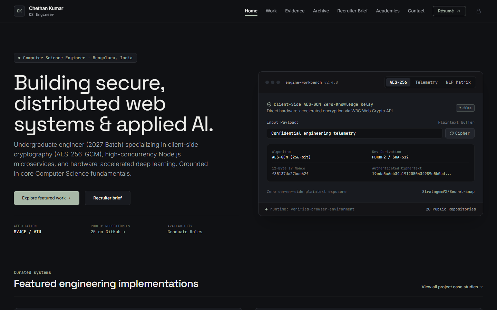
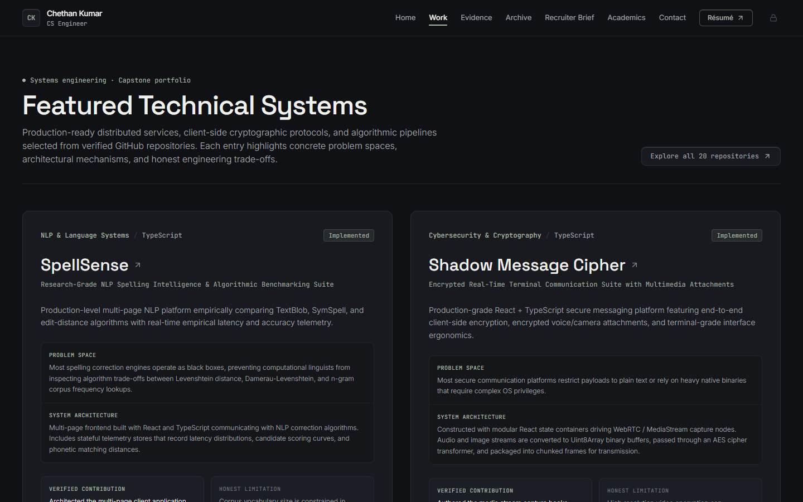
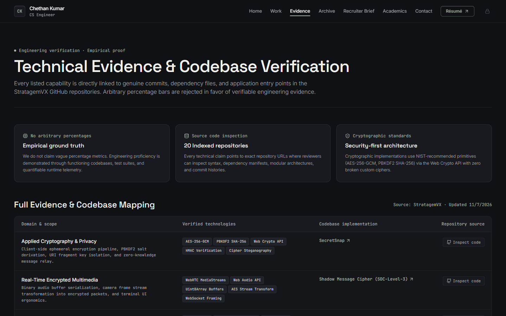
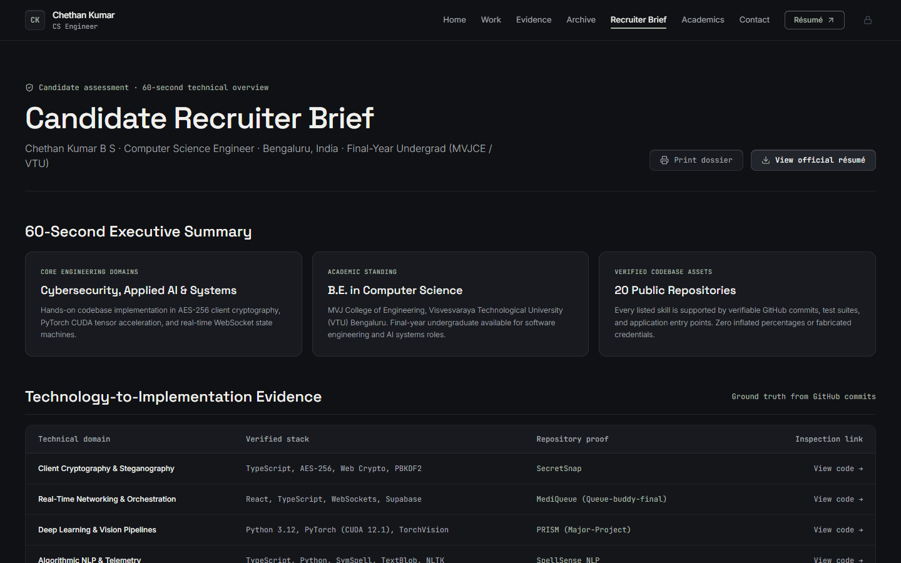
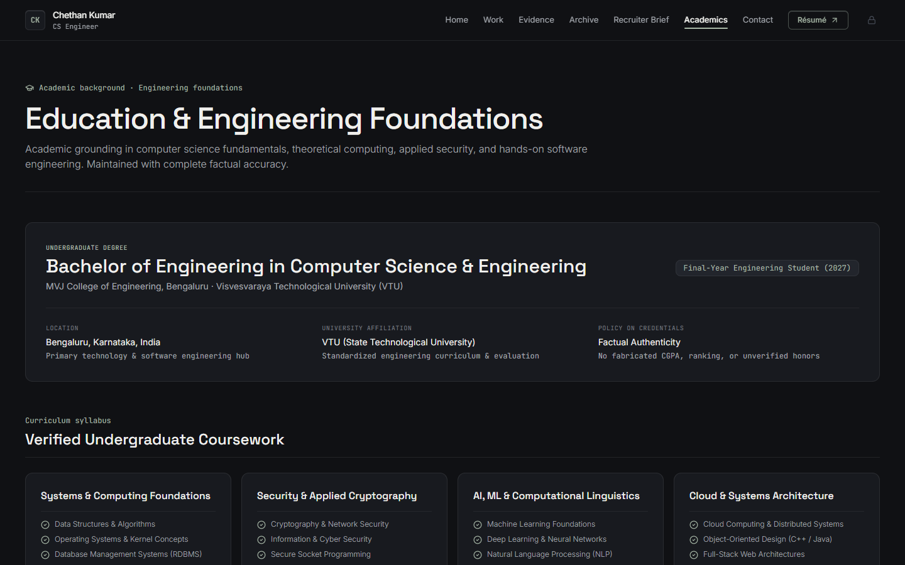
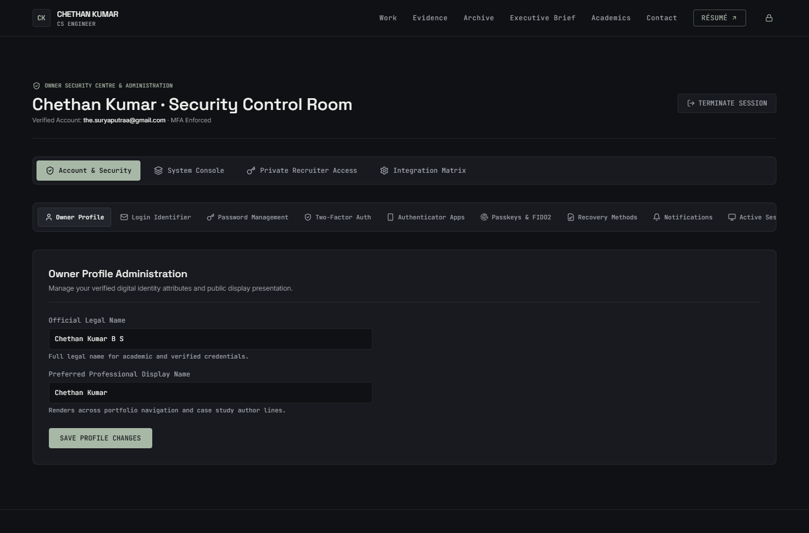
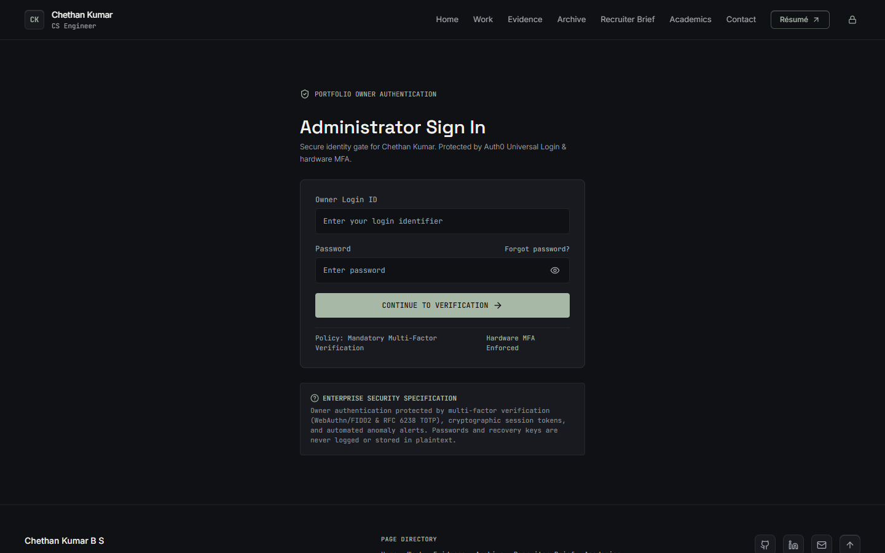
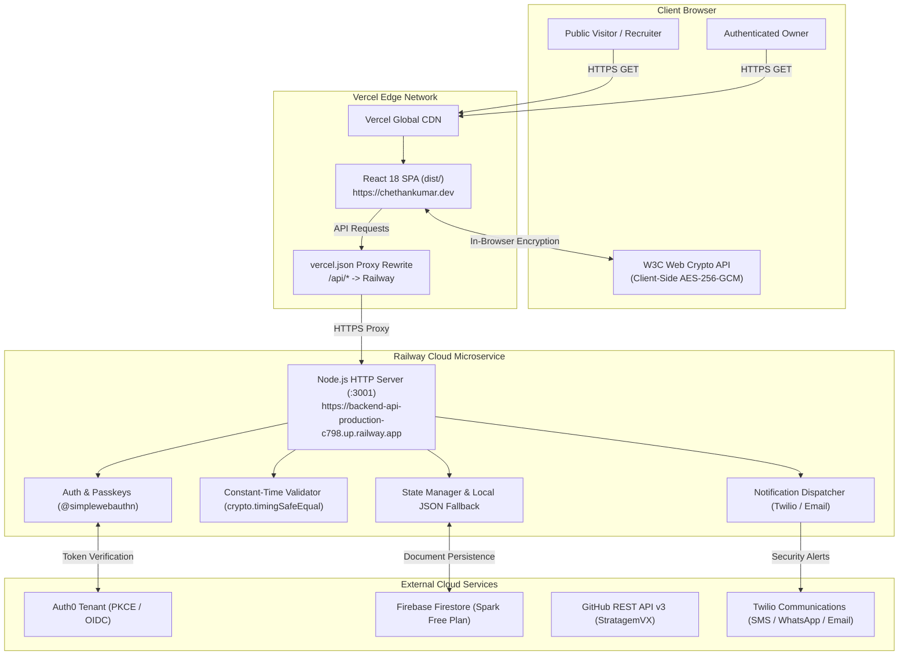

# Chethan Kumar — Personal Engineering Portfolio

> **A premium, evidence-driven engineering portfolio showcasing software development, intelligent systems, cybersecurity, and technical implementations.**

[](https://chethankumar.dev)
[](https://github.com/StratagemVX)
[](https://linkedin.com/in/chethan-kumar-b-s-781a002bb)
[-A8B8A7?style=flat-square&logo=vitest&logoColor=101114&labelColor=181A1F)](https://github.com/StratagemVX/myportfolio)
[](https://www.typescriptlang.org/)
[](https://react.dev/)

---

## 1. Overview

The **Chethan Kumar Engineering Portfolio** is a production-grade, evidence-driven web platform designed to present the software systems, cybersecurity implementations, and applied artificial intelligence research engineered by **Chethan Kumar B S**. 

### Purpose & Intended Audience
Unlike traditional developer portfolios that rely on generic templates, inflated proficiency percentages, and superficial project cards, this system serves technical recruiters, engineering leaders, and open-source reviewers who prioritize **empirical proof**. Every capability claimed across the portfolio is directly anchored to functioning codebases, public GitHub repositories, test suites, and verifiable runtime telemetry.

### Design Philosophy: "Security First. Intelligence Always."
- **Empirical Ground Truth:** Completely eliminates arbitrary self-assessment graphs (e.g., "95% Python") in favor of verifiable architecture diagrams, commit histories, and technical case studies.
- **Authentic Craftsmanship (Unslop Methodology):** Built strictly following the [Unslop](https://github.com/heydamir/unslop) design principles—disciplined typography, consistent 4px spatial rhythm, nested radius arithmetic, asymmetric layouts, and an intentional dark graphite visual identity.
- **Client-Side Cryptography:** Features an in-browser engineering instrument running hardware-accelerated AES-256-GCM encryption directly within the user's browser sandbox via the W3C Web Crypto API.
- **Zero Decorative Fluff:** No distracting purple gradients, pulsing neon badges, or AI marketing clichés. Every visual element reflects genuine systems engineering.

---

## 2. Project Preview

Authentic captures from the verified application running at desktop (1440×900 / 1536×864):

| Surface | Preview | Key Capabilities |
| :--- | :--- | :--- |
| **Homepage & Workbench** |  | Asymmetrical editorial hero, live Web Crypto AES-256-GCM workbench, PRISM latency telemetry, credential strip. |
| **Featured Systems** |  | Curated case studies featuring dual-spec panels (**Verified Contribution** vs. **Honest Limitation**). |
| **Technical Evidence Matrix** |  | Direct mapping from cryptographic & ML claims to public GitHub repositories and test entry points. |
| **Recruiter Brief & Dossier** |  | 60-second executive evaluation, candidate clearance token gate, and printable `@media print` dossier. |
| **Academic Foundations** |  | Computer Science undergraduate curriculum at MVJCE / VTU Bengaluru, featuring 4-column syllabus grid. |
| **Owner Security Control Room** |  | Protected admin center: RFC 6238 TOTP, WebAuthn Passkeys, single-use recovery codes, and IST audit log. |
| **Security Gate Entry** |  | Biometric Passkey authentication, constant-time password verification, and Auth0 PKCE gate. |

---

## 3. Key Implemented Features

### 3.1 Public Portfolio Experience
- **Interactive Engineering Workbench (`EngineeringWorkbench.tsx`):**
  - **AES-256-GCM Cryptographic Sandbox:** Real-time client-side encryption via `window.crypto.subtle`. Generates 12-byte IV nonces, produces authenticated ciphertext, and profiles execution latency in milliseconds.
  - **PRISM Telemetry Stream:** Live state synchronizer demonstrating sub-45ms latency benchmarks, concurrent socket tracking, and microservice status.
  - **SpellSense NLP Evaluation:** Dynamic programming Levenshtein distance visualizer comparing algorithmic lookups (SymSpell vs. TextBlob).
- **Flagship Project Case Studies (`/project/:slug`):** Comprehensive system deep-dives for SecretSnap, MediQueue, PRISM, SpellSense, and Shadow Message Cipher, complete with dynamic Mermaid architecture diagrams.
- **Public Repository Archive (`/archive`):** Searchable, real-time client-side index covering all 20 public GitHub repositories with classification by engineering domain.
- **Candidate Recruiter Brief (`/recruiter-brief`):** Executive summary tailored for engineering directors and recruiters, featuring a printable format (`window.print()`) and private token verification.
- **Academic Record (`/academics`):** Detailed undergraduate coursework breakdown at MVJ College of Engineering (VTU) paired with lab codebases.
- **Interactive Résumé (`/resume`):** Printable digital résumé paired with an embedded PDF viewer (`public/resume.pdf`).
- **Direct Contact Channels (`/contact`):** Instant clipboard copy with tactile feedback, verified communication handles, and PGP guidance.

### 3.2 Design System & Visual Identity
- **Graphite Palette:** Tailored dark interface utilizing deep canvas (`#101114`), card surfaces (`#181A1F`), elevated tiers (`#22252C`), and Muted Sage (`#A8B8A7`) accents.
- **Typography:** Modern editorial sans-serif (`Inter`) paired with monospace (`JetBrains Mono`) for cryptographic hashes, metrics, and code blocks.
- **Micro-Interactions:** Subtle top button highlights (`.btn-highlight`), thin 6px scrollbars, and snappy 150ms transitions.

### 3.3 Owner Security Center (`/admin`)
- **Multi-Factor Authentication (MFA):** Mandatory RFC 6238 TOTP with QR code generation compatible with Google Authenticator, Microsoft Authenticator, 1Password, and Bitwarden.
- **FIDO2 / WebAuthn Passkeys:** Passwordless biometric authentication (Windows Hello, Touch ID, YubiKey) via `@simplewebauthn`.
- **Single-Use Emergency Recovery Codes:** Cryptographically random backup codes stored exclusively as SHA-256 hashes on the server.
- **Session Management:** Real-time active session inspector displaying IP addresses, User-Agents, and IST timestamps, paired with a global session revocation kill switch.
- **Chronological Security Log:** Immutable audit trail capturing authentication events, profile updates, and MFA state changes in Indian Standard Time (IST / UTC+5:30).

### 3.4 Multi-Channel Notifications (`server/notificationService.ts`)
- **In-App Notifications:** Fully operational, dismissible security alert badges in the administration console.
- **Twilio SMS & WhatsApp:** E.164 transactional SMS and WhatsApp sandbox alerts triggered on security events.
- **Transactional Email:** Twilio Comms Email API integration with failover to Nodemailer SMTP and Resend.
- **Delivery Audit History:** Comprehensive delivery logs tracking timestamps, provider message IDs, and carrier delivery receipts.

---

## 4. Technology Stack

```
Frontend:
├── React 18.3 (Component Architecture)
├── TypeScript 5.4 (Strict Type Safety)
├── Vite 5.2 (Build Tooling & Fast HMR)
├── Tailwind CSS 3.4 (Design System)
├── React Router v6.23 (Client-Side Routing)
├── Lucide React (System Icons)
└── SimpleWebAuthn Browser (Client Passkeys)

Backend Microservice:
├── Node.js v20+ LTS (Native node:http Server)
├── SimpleWebAuthn Server (Passkey Assertion & Registration)
├── QRCode (Base32 OTPAuth QR Rendering)
├── Nodemailer (SMTP Transactional Fallback)
└── Dotenv (Environment Management)

Security & Cryptography:
├── W3C Web Crypto API (Client-Side AES-256-GCM & PBKDF2)
├── node:crypto (Constant-Time Comparisons & SHA-256 Hashing)
├── RFC 6238 TOTP (Time-Based One-Time Passwords)
└── FIDO2 / WebAuthn Level 3 (Hardware & Biometric Passkeys)

Cloud Hosting & Persistence:
├── Vercel (Edge CDN & Frontend SPA Deployment)
├── Railway (Backend Microservice Hosting & Healthchecks)
├── Firebase Firestore (Spark Plan Document Persistence)
└── GitHub Actions (Daily Automated Intelligence Sync)

Quality & Testing:
├── Vitest 1.6 (Unit & Security Test Runner)
└── TypeScript (Strict Typechecking via tsc)
```

---

## 5. System Architecture

The portfolio employs a decoupled architecture separating public edge delivery from protected security microservices:



For complete architectural details, see [`docs/ARCHITECTURE.md`](docs/ARCHITECTURE.md).

---

## 6. Repository Folder Structure

```
myportfolio/
├── .github/
│   └── workflows/
│       └── github-sync.yml      # Daily automated GitHub discovery cron (04:00 UTC)
├── docs/                        # Modular technical documentation
│   ├── ARCHITECTURE.md          # Topology, trust boundaries, and data flow
│   ├── FEATURES.md              # Complete public & administrative feature catalog
│   ├── LOCAL_SETUP.md           # Step-by-step developer workstation setup guide
│   ├── DEPLOYMENT.md            # Vercel, Railway, and Firebase deployment guides
│   ├── SECURITY.md              # Threat model, cryptographic primitives, and MFA
│   ├── GITHUB_SYNC.md           # Repository discovery engine & rate-limit handling
│   ├── NOTIFICATIONS.md         # Multi-channel notification delivery matrix
│   └── design/                  # Unslop design audits, directions, and changelog
├── public/                      # Static assets, résumé PDF, and service workers
│   ├── current-previews/        # Authentic desktop & mobile screenshot captures
│   ├── firebase-messaging-sw.js # Firebase Cloud Messaging web push worker
│   └── resume.pdf               # Official downloadable engineering résumé
├── scripts/
│   ├── sync-github.mjs          # Discovers public repos & updates projects.json
│   ├── capture-all.mjs          # Headless Playwright/Puppeteer screenshot capture
│   └── validate-responsive-widths.mjs
├── server/                      # Node.js security backend microservice
│   ├── index.ts                 # HTTP server entry point, CORS, and health checks
│   ├── apiHandler.ts            # REST endpoints (auth, MFA, sessions, audit)
│   ├── cryptoUtils.ts           # Constant-time comparison, TOTP, and token generators
│   ├── firebase.ts              # Firestore Admin SDK adapter with local fallback
│   ├── notificationService.ts   # Multi-channel notification dispatch & webhooks
│   ├── state.ts                 # Server state manager with JSON persistence
│   └── types.ts                 # Server-side TypeScript interfaces & types
├── src/                         # React 18 single page application
│   ├── components/
│   │   ├── admin/               # Owner security console panels & MFA flows
│   │   ├── home/                # EngineeringWorkbench interactive instrument
│   │   ├── Footer.tsx           # Site footer & repository snapshot metadata
│   │   ├── MermaidDiagram.tsx   # Dynamic client-side architecture diagrams
│   │   └── Navigation.tsx       # Site header, sentence-case navigation, & brand
│   ├── context/
│   │   └── ProfileContext.tsx   # Global owner display profile state
│   ├── data/
│   │   ├── projects.json        # Curated project index with case study details
│   │   └── github-snapshot.json # Raw GitHub discovery cache
│   ├── pages/                   # Route views (Home, Work, Evidence, Archive, etc.)
│   ├── services/
│   │   └── apiClient.ts         # Type-safe frontend client for backend endpoints
│   ├── App.tsx                  # Client router definition & route guards
│   ├── index.css                # Tailwind directives & custom utilities (.btn-highlight)
│   └── main.tsx                 # React application DOM entry point
├── tests/                       # Vitest automated test suites
│   ├── notification-infrastructure.test.ts # Twilio payload & status tests
│   ├── owner-security.test.ts   # Password, TOTP, and session token tests
│   └── portfolio.test.ts        # Route structure & project schema tests
├── .env.example                 # Sanitized environment template (no real secrets)
├── .gitignore                   # Git ignore rules protecting local credentials
├── firestore.rules              # Firebase Firestore default-deny security rules
├── package.json                 # Project dependencies and script declarations
├── railway.json                 # Railway Nixpacks deployment configuration
├── tailwind.config.js           # Design system tokens and graphite palette
├── tsconfig.json                # TypeScript compiler configuration
└── vercel.json                  # Vercel proxy rewrites & HTTP security headers
```

---

## 7. Installation & Local Development

### 7.1 Prerequisites
- **Node.js:** `v18.18+` or `v20.x LTS` (verified on Node 20).
- **npm:** `v9+` or `v10+`.
- **Git:** Standard git client.

### 7.2 Setup Steps

```bash
# 1. Clone the repository
git clone https://github.com/StratagemVX/myportfolio.git
cd myportfolio

# 2. Install dependencies
npm install

# 3. Create local environment configuration from template
cp .env.example .env
cp .env.example .env.local

# 4. Terminal 1: Start the Frontend SPA (Vite)
npm run dev

# 5. Terminal 2: Start the Backend Security Microservice
npm run server
```

- **Frontend URL:** `http://localhost:5173`
- **Backend URL:** `http://localhost:3001`
- **Backend Health Check:** `http://localhost:3001/health`

### 7.3 Available Scripts

| Script Command | Description |
| :--- | :--- |
| `npm run dev` | Starts Vite local development server with hot-module replacement. |
| `npm run server` | Starts the Node.js backend microservice via `vite-node server/index.ts`. |
| `npm run build` | Runs `tsc` strict typechecking followed by `vite build` to compile `dist/`. |
| `npm run preview` | Serves the production `dist/` bundle locally for verification. |
| `npm run test` | Executes the Vitest automated test suite (`41/41` passing). |
| `npm run sync:github` | Executes local GitHub repository discovery and updates `projects.json`. |

For operating-system-specific instructions and troubleshooting, see [`docs/LOCAL_SETUP.md`](docs/LOCAL_SETUP.md).

---

## 8. Environment Variables

The repository provides a sanitized template at [`.env.example`](.env.example). Never commit real secrets or production keys to version control.

### Client-Side Variables (Bundled into Browser)
Prefix with `VITE_`. These are public by design:
- `VITE_AUTH0_DOMAIN`: Auth0 tenant domain (e.g. `your-tenant.us.auth0.com`).
- `VITE_AUTH0_CLIENT_ID`: Auth0 SPA application client ID.
- `VITE_AUTH0_AUDIENCE`: Audience URL for backend API tokens.
- `VITE_PORTFOLIO_ENV`: `development` or `production`.

### Server-Side Variables (Strictly Private to Railway)
- `SECURITY_HMAC_KEY`: Random 256-bit seed key used for HMAC session signing.
- `ADMIN_PASSWORD`: Master passphrase for administrative authentication.
- `CORS_ALLOWED_ORIGINS`: Comma-separated list of allowed origins (e.g. `https://chethankumar.dev,https://chethan-kumar-portfolio.vercel.app`).
- `TWILIO_ACCOUNT_SID`, `TWILIO_API_KEY_SID`, `TWILIO_API_KEY_SECRET`: Twilio credentials for SMS/Email/WhatsApp alerts.
- `FIREBASE_PROJECT_ID`, `FIREBASE_CLIENT_EMAIL`, `FIREBASE_PRIVATE_KEY`: Firebase Admin SDK credentials for Firestore persistence.

---

## 9. Authentication & Security Model

- **Constant-Time Verification:** Administrative password checks utilize `crypto.timingSafeEqual` over fixed-length SHA-256 digests, eliminating side-channel timing attacks.
- **MFA Enforcement:** Administrative session creation requires a valid RFC 6238 TOTP token or WebAuthn Passkey assertion.
- **Session Tokens:** 256-bit cryptographically secure random session tokens are transmitted exclusively via HTTP Authorization Bearer headers (immune to CSRF attacks). Tokens are stored hashed (SHA-256) on the server and expire after 24 hours.
- **Session Kill Switch:** The Owner Security Console allows instant, one-click revocation of all other active sessions across devices.
- **Emergency Recovery:** Single-use alphanumeric recovery codes (`XXXX-XXXX`) are destroyed immediately upon use.

For detailed security specifications, see [`docs/SECURITY.md`](docs/SECURITY.md).

---

## 10. GitHub Intelligence & Synchronization

The portfolio continuously mirrors the public repositories of [`https://github.com/StratagemVX`](https://github.com/StratagemVX) via `scripts/sync-github.mjs`:
- **Automated Filtering:** Excludes forks and drafts to highlight genuine original codebases.
- **Domain Mapping:** Categorizes projects into *Cybersecurity*, *Applied AI*, *NLP Systems*, and *Distributed Systems*.
- **Curation Preservation:** Automated updates refresh star counts and commit timestamps while strictly preserving manually authored case studies and Mermaid diagrams.
- **Rate-Limit Resilience:** Gracefully falls back to existing JSON snapshots if GitHub API rate limits are reached (HTTP 403).

For complete discovery engine details, see [`docs/GITHUB_SYNC.md`](docs/GITHUB_SYNC.md).

---

## 11. Deployment

The system is deployed using a decoupled architecture:
- **Frontend on Vercel:** Continuous deployment from GitHub with `vercel.json` rewrites and strict security headers (`X-Frame-Options: DENY`, `X-Content-Type-Options: nosniff`). Custom domain: `https://chethankumar.dev`.
- **Backend on Railway:** Deployed via `railway.json` using Nixpacks. Includes automated health checks on `/health` and `/health/ready`.
- **Database on Firebase Firestore:** Free Spark plan document storage with `firestore.rules` enforcing a strict default-deny boundary.

For step-by-step production setup, see [`docs/DEPLOYMENT.md`](docs/DEPLOYMENT.md).

---

## 12. Automated Testing

The project includes unit and integration tests powered by Vitest:

```bash
npm run test
```

### Verified Test Results:
- **`tests/portfolio.test.ts` (5 tests):** Validates project schema, slug formatting, case study integrity, and navigation links.
- **`tests/owner-security.test.ts` (18 tests):** Validates constant-time password comparisons, RFC 6238 TOTP verification, session TTL expiration, and recovery code consumption.
- **`tests/notification-infrastructure.test.ts` (18 tests):** Validates Twilio SMS, WhatsApp, and Comms Email payload formatting, delivery status normalization, and webhook callbacks.
- **Overall Result:** `41 passed (100% pass rate)`.

---

## 13. Troubleshooting & Known Considerations

| Symptom / Error | Root Cause | Solution |
| :--- | :--- | :--- |
| **CORS Blocked on API Calls** | Origin not in allowed list | Add the origin to `CORS_ALLOWED_ORIGINS` in Railway environment settings. |
| **GitHub Sync Rate Limit (403)** | Unauthenticated API quota exceeded (60 req/hr) | Add a personal `GITHUB_TOKEN` to your environment or GitHub Action secrets. |
| **Twilio SMS Not Delivered** | Twilio trial account restriction | The destination phone number must be added to **Verified Caller IDs** in the Twilio Console. |
| **Firebase Admin Auth Failure** | Private key newline escaping in Railway | Ensure `FIREBASE_PRIVATE_KEY` has newlines entered as `\n` enclosed in double quotes. |
| **WebAuthn Passkey Registration Fails** | Insecure context / non-HTTPS | WebAuthn requires a secure origin (`https://` or `localhost`). Verify origin matches `window.location.origin`. |

---

## 14. Current Project Status & Honest Limitations

### Completed & Fully Operational:
- Public portfolio experience across all 9 routes (Home, Work, Case Studies, Evidence, Archive, Recruiter Brief, Academics, Contact, Résumé).
- Interactive Engineering Workbench (Web Crypto AES-256-GCM, PRISM telemetry, SpellSense matrix).
- Unslop design system implementation across all screens.
- Owner Security Control Room with RFC 6238 TOTP, WebAuthn Passkeys, and session revocation.
- Automated GitHub repository discovery engine and daily CI/CD sync workflow.
- Vitest test suite (`41/41` tests passing).

### Operational Nuances & Limitations:
- **Twilio SMS in Trial Mode:** Messages include standard Twilio trial prefixes and can only be delivered to pre-verified phone numbers until an upgraded commercial balance is applied.
- **WhatsApp Sender Approval:** Twilio WhatsApp notifications currently operate in Sandbox mode (`whatsapp:+14155238886`) pending Meta Business Verification for commercial sender templates.
- **Web Push Notifications (FCM):** Service worker is implemented; awaiting production VAPID credentials for live web push dispatch.

---

## 15. Realistic Engineering Roadmap

- [ ] **Hardware WebAuthn Enhancements:** Support for multi-device Passkey synchronization and FIDO2 PIN protocols.
- [ ] **Automated Performance Telemetry:** Continuous Lighthouse Core Web Vitals profiling via GitHub Actions.
- [ ] **Expanded Cryptographic Benchmarks:** In-browser post-quantum lattice cryptography demonstrations (Kyber / Dilithium) via WebAssembly.
- [ ] **Interactive Case Study Playgrounds:** Live code execution sandboxes for algorithmic NLP pipelines.

---

## 16. Author & Professional Contact

**Chethan Kumar B S**  
*Computer Science Engineer · Applied AI · Cybersecurity · Distributed Systems*  
Bengaluru, India (IST / UTC+5:30)

- **Portfolio:** [https://chethankumar.dev](https://chethankumar.dev)
- **GitHub:** [@StratagemVX](https://github.com/StratagemVX)
- **LinkedIn:** [Chethan Kumar B S](https://linkedin.com/in/chethan-kumar-b-s-781a002bb)
- **Email:** [chethan.athulith@outlook.com](mailto:chethan.athulith@outlook.com)

---

## 17. License & Attributions

- **Proprietary Portfolio Implementation:** All original code, text, case studies, and visual arrangements © 2026 Chethan Kumar B S. No open-source reuse license is granted for personal identity materials; all rights reserved.
- **Third-Party Design Attribution:** The design methodology and refinement passes are guided by the [Unslop](https://github.com/heydamir/unslop) project by Damir Sokolovsky ([@heydamir](https://github.com/heydamir)), licensed under [Creative Commons Attribution 4.0 International (CC BY 4.0)](https://creativecommons.org/licenses/by/4.0/). See [`THIRD_PARTY_NOTICES.md`](THIRD_PARTY_NOTICES.md) for full notices.
