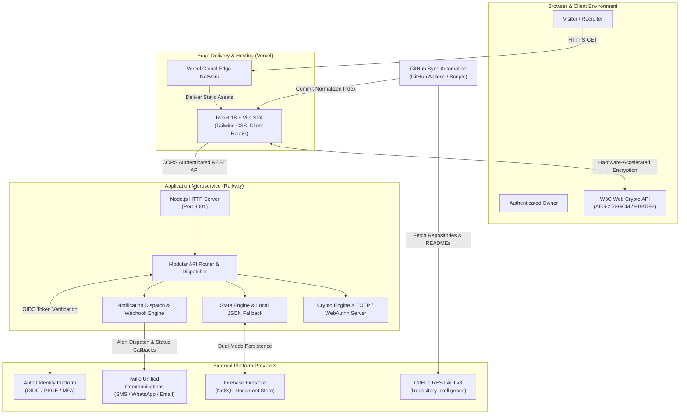
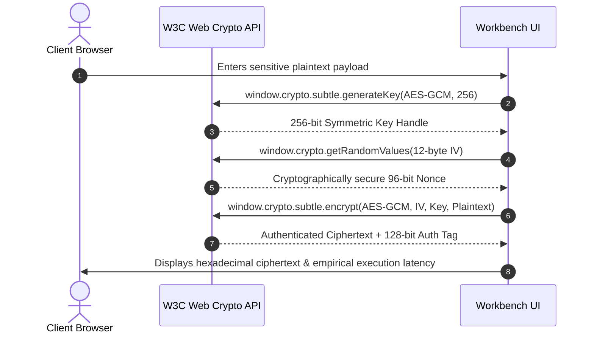

# System Architecture & Technical Specifications

This document details the architectural topology, data flow patterns, security boundaries, and persistence mechanisms of the Chethan Kumar Engineering Portfolio.

---

## 1. High-Level Architectural Topology

The application utilizes a decoupled, modern multi-tier architecture composed of a statically generated, client-rendered Single Page Application (SPA) hosted on Vercel, paired with a specialized Node.js security microservice hosted on Railway. External identity, persistent state, and event notifications are managed via Auth0, Firebase Firestore, GitHub REST APIs, and Twilio.

---

## 2. Core Architectural Layers

### 2.1 Frontend Single Page Application (SPA)
- **Framework & Tooling:** React 18.3, TypeScript 5.4, Vite 5.2.
- **Routing:** Client-side routing powered by `react-router-dom` (v6.23) with clean, declarative route guards and single-page deep link rewrites via `vercel.json`.
- **Design System & Styling:** Custom dark graphite design system built on Tailwind CSS (v3.4) adhering to the strict **Unslop** craft guidelines (4px vertical rhythm, asymmetric layouts, nested radius arithmetic, zero artificial glows or purple gradients).
- **Client-Side Cryptography:** Fully hardware-accelerated W3C Web Crypto API (`window.crypto.subtle`) executing AES-256-GCM encryption and PBKDF2 key derivation directly inside the visitor's browser sandbox.

### 2.2 Security & Notification Backend Microservice
- **Runtime:** Node.js (v20+ LTS) running on Railway with zero bloated web framework overhead (direct native `node:http` request handling).
- **Security Primitives:**
  - Standard RFC 6238 Time-Based One-Time Password (TOTP) generation and verification.
  - W3C WebAuthn Level 3 Passkey registration and assertion via `@simplewebauthn/server`.
  - Cryptographic token generation via `node:crypto` (`randomBytes`, SHA-256, HMAC-SHA256).
  - Timing attack defense utilizing `crypto.timingSafeEqual`.
- **Session Model:** Stateful Bearer token authentication with SHA-256 token hashing, 24-hour TTL, and active IP/User-Agent tracking.

### 2.3 Persistence & Fallback Tier
- **Primary Cloud Store:** Firebase Firestore (Spark Free Tier) utilizing structured document collections:
  - `owner_profile/current`: Core owner preferences, display names, masked identifiers, and MFA enrollment metadata.
  - `audit_logs/{id}`: Chronological security event history with IST timestamps and client fingerprints.
  - `fcm_tokens/{token}`: Registered web push notification endpoint subscriptions.
- **Graceful Local Fallback:** When Firebase credentials are not provided (e.g., during isolated local development or air-gapped environments), the backend automatically engages `server/security-state.json` and `server/notifications-log.json`, ensuring zero operational disruption.

### 2.4 External Notification Dispatch Tier
- **Unified Engine (`server/notificationService.ts`):** Multi-channel alert dispatcher supporting:
  - **Twilio SMS:** Direct E.164 transactional SMS delivery with carrier status webhooks.
  - **Twilio WhatsApp:** Messaging sandbox integration with interactive reply hooks.
  - **Twilio Comms Email:** Transactional security alert delivery with fallback to Nodemailer SMTP / Resend.
  - **In-App Notification Feed:** Ephemeral, dismissible security badges accessible directly within the Owner Security Console.

---

## 3. Trust Boundaries & Security Zones

| Security Zone | Components | Trust Level | Enforced Controls |
| :--- | :--- | :--- | :--- |
| **Zone 1: Public Client** | Browser, React SPA, Static Assets | Untrusted | No secrets in client bundles; all sensitive data masked; client cryptography runs locally without transmitting plaintext keys. |
| **Zone 2: Edge Delivery** | Vercel Global Edge Network, CDN | Semi-Trusted | HTTPS TLS 1.3 enforcement; strict CORS headers; SPA rewrite fallbacks to `index.html`. |
| **Zone 3: API Microservice** | Railway Node.js Service, `server/` | Trusted | Enforces Bearer token session authentication; timing-safe comparisons; rate-limiting; input validation. |
| **Zone 4: Identity & State** | Auth0, Firebase Firestore | Highly Trusted | Service Account credentials stored strictly as Railway server environment variables; Firestore security rules. |
| **Zone 5: Notification Providers** | Twilio, Resend, SMTP | Trusted External | API credentials isolated on backend; delivery callbacks verified against HMAC signatures. |

---

## 4. Client-Side Cryptographic Workbench Model (SecretSnap)

The interactive cryptographic workbench (`src/components/home/EngineeringWorkbench.tsx`) implements a genuine client-side zero-knowledge relay architecture:

- **Zero Plaintext Transmission:** Plaintext payloads and derived cryptographic keys never leave the browser sandbox.
- **URI Fragment Isolation:** In the companion project `SecretSnap`, cryptographic keys are stored exclusively in the URI hash fragment (`#key=...`), which is never transmitted to web servers in HTTP request headers.
