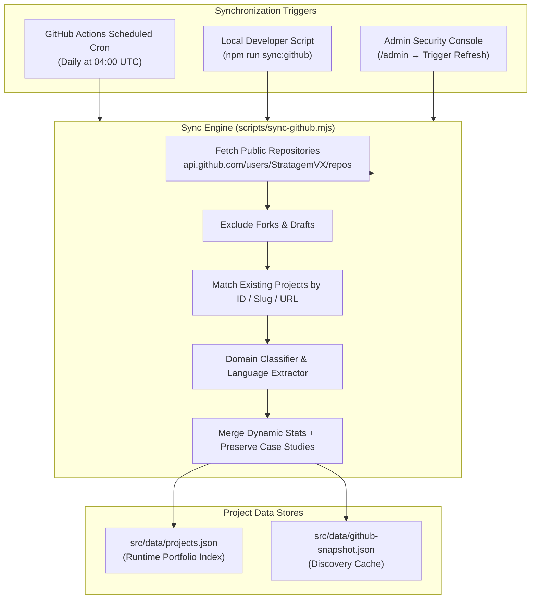

# GitHub Repository Synchronisation Engine

This document details the automated GitHub repository discovery and synchronization engine that powers the project catalog in the Chethan Kumar Engineering Portfolio.

---

## 1. Synchronization Architecture

The portfolio continuously mirrors public repositories from the GitHub profile [`https://github.com/StratagemVX`](https://github.com/StratagemVX) while preserving manually authored engineering case studies, Mermaid architecture diagrams, and trade-off specifications.



---

## 2. Discovery & Normalization Workflow

### 2.1 API Endpoint & Discovery
The script (`scripts/sync-github.mjs`) calls:
```
GET https://api.github.com/users/StratagemVX/repos?per_page=100&sort=updated
```
If `GITHUB_TOKEN` is present in the runtime environment, it includes:
```
Authorization: token ${process.env.GITHUB_TOKEN}
```
This increases the GitHub API rate limit from **60 requests/hour** to **5,000 requests/hour**.

### 2.2 Fork Filtering
Raw forks (`repo.fork === true`) are automatically filtered out from featured representation, ensuring the portfolio showcases genuine original software engineering.

### 2.3 Domain Classification Heuristics
When a newly discovered repository lacks a curated category, the engine infers its domain using keyword classification:

| Repository Name / Topic Keywords | Assigned Classification Domain |
| :--- | :--- |
| `crypto`, `cipher`, `secret`, `snap`, `security` | **Cybersecurity & Cryptography** |
| `prism`, `ml`, `torch`, `deep`, `vision`, `neural` | **AI & Machine Learning** |
| `nlp`, `spell`, `sense`, `text`, `linguistics` | **NLP & Language Systems** |
| `queue`, `finance`, `mitra`, `activity`, `service` | **Full-Stack Development** |
| `lab`, `academic`, `college`, `vtu`, `coursework` | **Academic & Laboratory** |
| *Default fallback* | **Cloud & Distributed Systems** |

---

## 3. Preservation of Curated Case Studies

A primary design requirement is that automated updates to repository metadata (such as star counts, last pushed timestamps, and primary languages) must **never overwrite** manually authored engineering analyses.

The synchronization pipeline preserves:
- `problemStatement`: The formal engineering challenge and problem space.
- `purpose` & `targetUsers`: Intended audience and functional rationale.
- `keyCapabilities`: Concrete verified features.
- `architectureOverview`: Systems architecture text.
- `systemFlowDiagram`: Raw Mermaid diagram definitions.
- `myContribution`: Specific individual authorship claims.
- `technicalChallenges`: Solutions to engineering hurdles.
- `limitations`: Honest documentation of technical trade-offs.
- `futureWork`: Realistic development roadmaps.

---

## 4. Rate-Limit Handling & Failure Modes

- **HTTP 403 Rate Limit:** If the GitHub API returns HTTP 403 (Rate Limit Reached), the sync script outputs a descriptive warning and exits gracefully. The existing `src/data/projects.json` file is preserved untouched, preventing site corruption.
- **Network Failures:** In air-gapped or offline development environments, Vite and React fall back directly to the local JSON snapshot with zero runtime errors.

---

## 5. Automated CI/CD Workflow (`.github/workflows/github-sync.yml`)

The portfolio maintains freshness through a daily automated GitHub Action:

```yaml
name: GitHub Portfolio Synchronisation

on:
  schedule:
    - cron: '0 4 * * *' # Daily at 04:00 UTC
  workflow_dispatch:
  push:
    branches:
      - main
    paths:
      - 'scripts/sync-github.mjs'

jobs:
  synchronize-portfolio:
    runs-on: ubuntu-latest
    steps:
      - uses: actions/checkout@v4
      - uses: actions/setup-node@v4
        with:
          node-version: '20'
          cache: 'npm'
      - run: npm ci
      - run: node scripts/sync-github.mjs
        env:
          GITHUB_TOKEN: ${{ secrets.GITHUB_TOKEN }}
      - name: Commit & Push Changes
        run: |
          git config user.name "StratagemVX Sync Automation"
          git config user.email "bot@stratagemvx.internal"
          git add src/data/projects.json src/data/github-snapshot.json
          git diff --staged --quiet || git commit -m "chore(sync): automated repository index update [skip ci]"
          git diff --staged --quiet || git push origin main
```
