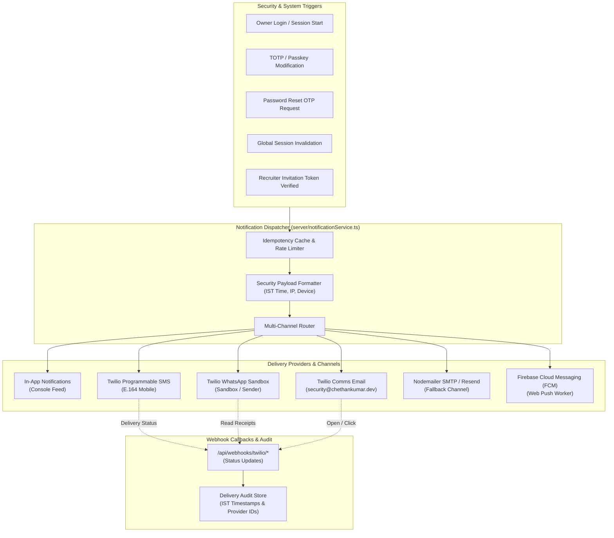

# Notification Infrastructure & Delivery Matrix

This document provides technical documentation for the unified multi-channel notification engine implemented in `server/notificationService.ts`.

---

## 1. Notification Architecture Overview

The portfolio incorporates an event-driven notification engine that alerts the repository owner in real-time when critical security events occur (administrative logins, MFA enrollment modifications, session revocations, password resets, and recruiter token verifications).

---

## 2. Notification Delivery Lifecycle & Statuses

Every notification dispatch is tracked with a normalized status lifecycle:

| Status Code | Definition | Required Action |
| :--- | :--- | :--- |
| `ACCEPTED` | Successfully received and queued by the external provider API. | No action required; awaiting carrier delivery confirmation. |
| `DELIVERED` | Explicitly confirmed delivered to the owner's device via webhook. | Final successful state. |
| `UNDELIVERED` | Delivery attempted by carrier but failed (e.g., unreachable device). | Review phone connectivity or provider error code. |
| `FAILED` | Provider rejected the dispatch payload (e.g., invalid authentication). | Check API credentials or sender registration. |
| `BLOCKED_CONFIGURATION` | Required credentials (e.g., Account SID or API Key) are unpopulated. | Populate environment variables in Railway. |
| `AWAITING_RECIPIENT_VERIFICATION` | Twilio trial account restriction: recipient phone number has not been verified in the Twilio console. | Add phone number to Twilio Verified Caller IDs. |
| `AWAITING_BUSINESS_APPROVAL` | WhatsApp commercial sender template requires Meta business verification. | Use Twilio WhatsApp Sandbox until approved. |

---

## 3. Supported Notification Channels

### 3.1 In-App Notifications
- **Implementation:** Ephemeral, dismissible security alerts stored in local/Firestore state.
- **Access:** Rendered in the Owner Security Console header with severity badges (`INFO`, `WARNING`, `CRITICAL`).
- **Status:** **Fully Implemented & Active.**

### 3.2 Twilio Programmable SMS
- **Implementation:** REST API calls to `https://api.twilio.com/2010-04-01/Accounts/{AccountSid}/Messages.json`.
- **Target:** Verified owner phone number in E.164 international format (`+91XXXXXXXXXX`).
- **Trial Account Behavior:** On Twilio Trial accounts, SMS can only be delivered to Verified Caller IDs. If unverified, the engine records an `AWAITING_RECIPIENT_VERIFICATION` status with clear resolution instructions.
- **Status:** **Implemented; Active when credentials are configured.**

### 3.3 Twilio WhatsApp Messaging
- **Implementation:** Sandbox dispatch via `whatsapp:+14155238886` with callback tracking.
- **Joining the Sandbox:** To receive WhatsApp notifications, the recipient device must send a one-time message `join <sandbox-keyword>` to the Twilio WhatsApp number.
- **Status:** **Implemented for Sandbox; awaiting Meta business verification for custom brand sender.**

### 3.4 Twilio Comms Email API / Nodemailer Fallback
- **Implementation:** Primary dispatch via Twilio Comms Email API (`https://comms.twilio.com/v1/Emails`), with automatic failover to Nodemailer SMTP or Resend.
- **Sender Domain:** `security@chethankumar.dev` (requires DNS SPF/DKIM verification).
- **Status:** **Implemented; fallback active.**

### 3.5 Firebase Cloud Messaging (Web Push)
- **Implementation:** Service worker at `public/firebase-messaging-sw.js` with server registration endpoint `/api/notifications/fcm/register`.
- **Status:** **Schema and worker ready; awaiting FCM VAPID public key.**

---

## 4. Webhook Handlers & Status Callbacks

The backend listens for provider delivery receipts on the following routes:

- `POST /api/webhooks/twilio/sms`: Receives `MessageStatus` (`sent`, `delivered`, `failed`, `undelivered`).
- `POST /api/webhooks/twilio/whatsapp`: Receives WhatsApp message delivery and read receipts.
- `POST /api/webhooks/twilio/email`: Receives email delivery events (`delivered`, `bounced`, `spam_report`).
- `POST /api/webhooks/resend`: Receives Resend delivery event webhooks.

### Audit Inspection:
Administrators can inspect live delivery audit logs directly in the **Owner Security Console** under the **Activity** tab, displaying IST timestamps, carrier response codes, and delivery statuses.
