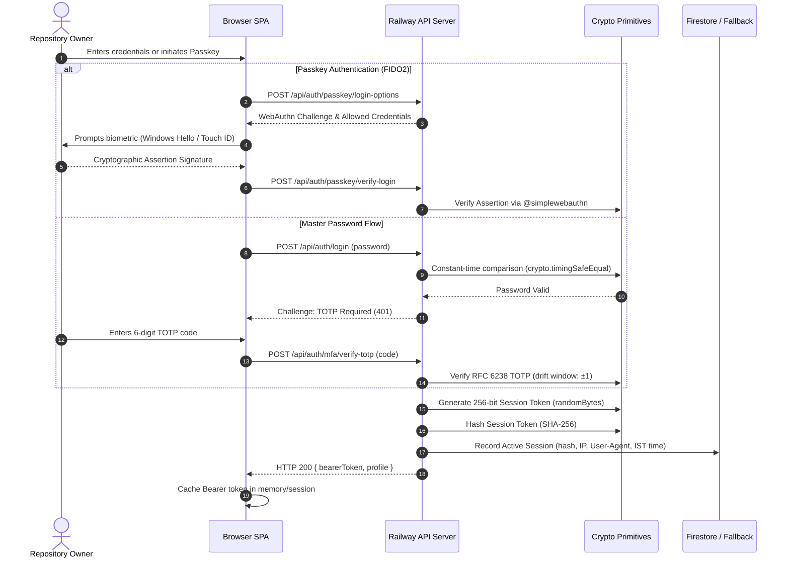

# Security Architecture & Threat Model

This document outlines the security architecture, cryptographic implementations, authentication workflows, and defensive controls implemented across the Chethan Kumar Engineering Portfolio.

---

## 1. Authentication Architecture & Workflows

Administrative capabilities are protected by a defense-in-depth security model combining SSO, constant-time password verification, Time-Based One-Time Passwords (TOTP), and FIDO2/WebAuthn Passkeys.



---

## 2. Multi-Factor Authentication (MFA) Implementation

### 2.1 RFC 6238 Time-Based One-Time Password (TOTP)
- **Algorithm:** HMAC-SHA1 with 6-digit numeric output and standard 30-second time steps.
- **Secret Generation:** 20-byte cryptographically secure pseudorandom number generator (`crypto.randomBytes(20)`) encoded as Base32.
- **Drift Tolerance:** Validates current window, previous window (-30s), and forward window (+30s) to handle slight client clock drift without compromising security.
- **QR Code Provisioning:** Uses standard `otpauth://totp/...` URI specification rendered client-side via `qrcode` data URLs. Compatible with Google Authenticator, Microsoft Authenticator, 1Password, and Bitwarden.

### 2.2 W3C WebAuthn Level 3 / FIDO2 Passkeys
- **Libraries:** `@simplewebauthn/browser` on client; `@simplewebauthn/server` on backend.
- **Attestation & User Verification:** Configured for `userVerification: 'preferred'`, enabling seamless biometric verification (Touch ID, Windows Hello, Face ID) or hardware security tokens (YubiKey 5 Series).
- **Counter Validation:** Tracks signature counters to detect and block cloned authenticator attacks.

### 2.3 Single-Use Emergency Recovery Codes
- **Generation:** Generates 8 cryptographically random alphanumeric backup codes formatted as `XXXX-XXXX`.
- **Server Storage:** Codes are never stored in plaintext on the server; they are hashed via SHA-256 before persistence.
- **Consumption:** Upon verification, the matching hash is immediately deleted from state, preventing replay attacks.

---

## 3. Cryptographic Primitives & Client-Side Sandbox

The portfolio features the **Engineering Workbench** (`SecretSnap`), executing client-side authenticated cryptography in the browser:

```typescript
// Client-Side Hardware-Accelerated AES-256-GCM via W3C Web Crypto API
const key = await window.crypto.subtle.generateKey(
  { name: 'AES-GCM', length: 256 },
  true,
  ['encrypt', 'decrypt']
);

const iv = window.crypto.getRandomValues(new Uint8Array(12)); // 96-bit unique nonce

const encrypted = await window.crypto.subtle.encrypt(
  { name: 'AES-GCM', iv },
  key,
  new TextEncoder().encode(plainText)
);
```

- **Zero Plaintext Server Exposure:** Neither plaintext nor encryption keys are transmitted over the network.
- **Key Derivation (PBKDF2):** Derives cryptographic keys from user passphrases using PBKDF2 with SHA-256 and salt parameters, preventing dictionary attacks.

---

## 4. Threat Model & Defensive Controls

| Attack Vector | Threat Level | Implemented Defensive Control |
| :--- | :--- | :--- |
| **Timing Attacks** | Medium | Password comparisons utilize `crypto.timingSafeEqual` over fixed-length SHA-256 digests. String length variations do not leak timing information. |
| **Credential Stuffing** | High | Mandatory MFA (TOTP or Passkey) blocks unauthorized access even if credentials are exposed. |
| **Replay Attacks** | High | Single-use recovery codes are invalidated instantly. WebAuthn challenges are single-use with cryptographic timeouts. |
| **Session Hijacking** | Medium | Session tokens are transmitted exclusively via HTTP Authorization Bearer headers (immune to CSRF). Sessions expire in 24 hours and can be revoked globally with one click. |
| **PII Data Exposure** | Medium | Frontend models strictly receive masked contact information (`t***@g***.com`, `+91 ***-***-9287`). Plaintext phone numbers and personal emails are isolated to server environment variables. |
| **Brute Force & Flooding** | High | Rate-limiting on authentication and notification test endpoints. Twilio notification requests enforce strict idempotency caches. |
| **XSS & Content Injection** | High | Strict HTTP Content Security Policy (CSP) headers configured in `vercel.json`: `X-Content-Type-Options: nosniff`, `X-Frame-Options: DENY`, `Referrer-Policy: strict-origin-when-cross-origin`. |

---

## 5. Session Invalidation & Emergency Revocation

The Owner Security Console provides immediate operational responses in the event of suspected device compromise:
- **Global Invalidation (`/api/sessions/revoke-others`):** Destroys all active session records in Firestore and local state, instantly logging out all external browsers.
- **Password Reset with Email OTP:** Resetting the administrative master password requires a time-limited 6-digit OTP delivered to the verified recovery email.
- **Audit Logging:** Every administrative action generates an immutable audit record containing IST timestamps, IP addresses, and user-agent fingerprints.
